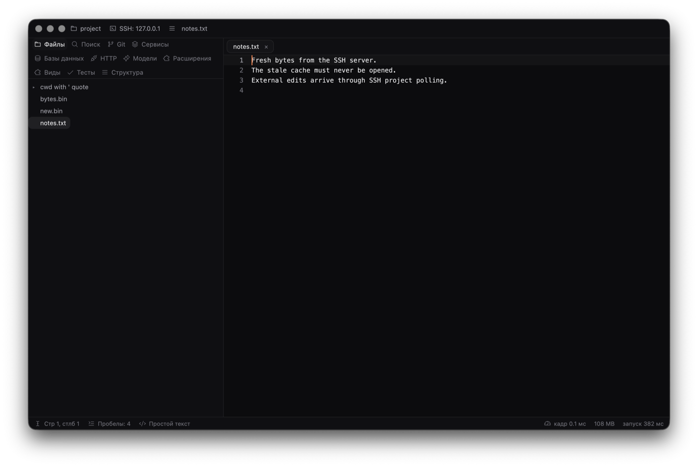

# Remote projects: verification and benchmark

Measured on 2026-10-13, main `5ce3345` against `feat/remote-projects`
`f8c1933`. Rust 1.94.0 release builds on arm64 macOS 26.6.2 (Apple M4),
outside iCloud and in separate target folders. Both opened the same Rust
fixture (`editor.rs`, 128,463 bytes), outside a Git checkout.

Each invocation used a fresh isolated HOME, default settings/layout and no
installed extensions. No remote connection or container was active. No builds,
test runners or preview windows were active during measurement; the standard
script finished its cached build before launching each benchmark. Other user
applications remained open. These are fresh processes with disk caches warm,
not disk-cold starts. No website performance claim was changed.

## Standard script

`editor/scripts/bench.sh` ran once on each build:

- base: cold_start_ms=128.9 (runs: 146.6 142.3 125.1 128.9 125.7); input_p50_ms=12 input_p99_ms=22 frame_p50_ms=1.4 frame_p99_ms=2.0 memory_mb=156
- branch: cold_start_ms=121.4 (runs: 121.4 123.5 126.2 119.4 121.0); input_p50_ms=12 input_p99_ms=21 frame_p50_ms=1.4 frame_p99_ms=2.1 memory_mb=162

## Interleaved startup

One warm-up per build, then two rounds of 21 launches per build. The build
run first alternated on each pair and on the second round. Milliseconds,
least / median / most:

- Round 1, base: 120.6 / 126.3 / 138.1
- Round 1, branch: 119.1 / 126.3 / 142.4
- Round 2, base: 127.4 / 133.8 / 149.7
- Round 2, branch: 125.9 / 131.8 / 149.0

## Typing

300 inputs, 16 ms apart. Three interleaved runs per build, reversing order
in the second pair:

- Run 1, base: input_p50_ms=12 input_p99_ms=21 frame_p50_ms=1.5 frame_p99_ms=1.8 memory_mb=168
- Run 1, branch: input_p50_ms=12 input_p99_ms=22 frame_p50_ms=1.4 frame_p99_ms=1.9 memory_mb=156
- Run 2, branch: input_p50_ms=12 input_p99_ms=22 frame_p50_ms=1.4 frame_p99_ms=2.2 memory_mb=154
- Run 2, base: input_p50_ms=12 input_p99_ms=21 frame_p50_ms=1.4 frame_p99_ms=2.3 memory_mb=161
- Run 3, base: input_p50_ms=12 input_p99_ms=22 frame_p50_ms=1.5 frame_p99_ms=2.2 memory_mb=161
- Run 3, branch: input_p50_ms=12 input_p99_ms=22 frame_p50_ms=1.5 frame_p99_ms=2.0 memory_mb=158

The binary changed from 53,615,984 to 54,337,488 bytes (+721,504 bytes).

Startup medians are equal in the first paired round; the branch is 2.0 ms
lower in the second. Input p99 is 21–22 ms for both builds. Memory footprints
overlap (156–168 MB for base, 154–162 MB for branch). These samples show no
consistent slowdown; they establish no performance guarantee. Raw samples
and complete typing output are in [remote-projects.json](remote-projects.json).

Not measured: active SSH or container work, network latency, large remote
inventories, populated service panels, SSH PTYs, reconnect or connection loss,
and other platforms.

## Native SSH window

A release Solder process used an isolated HOME and temporary public-key SSH
server on macOS loopback. A cache file initially held stale bytes. Opening
that file on the command line connected through the integrated Rust channel
and displayed the server bytes instead. Changing the server file then reached
the open document through project polling. The Russian window was captured
and visually inspected: project tree, SSH environment label and updated text
were visible. No keyboard input or save in this native window was exercised.

The same run also passed seven first-party helper checks: handshake, binary
read, atomic compare-and-save, equal-stamp hash conflict, exclusive create,
path/symlink confinement, and command cwd/argv/environment. Verification facts
are in [remote-projects-ssh.json](remote-projects-ssh.json). Keys, server config,
temporary project, and launched processes were removed. No published extension
code, Docker daemon, image build, pull or external SSH host was used.

