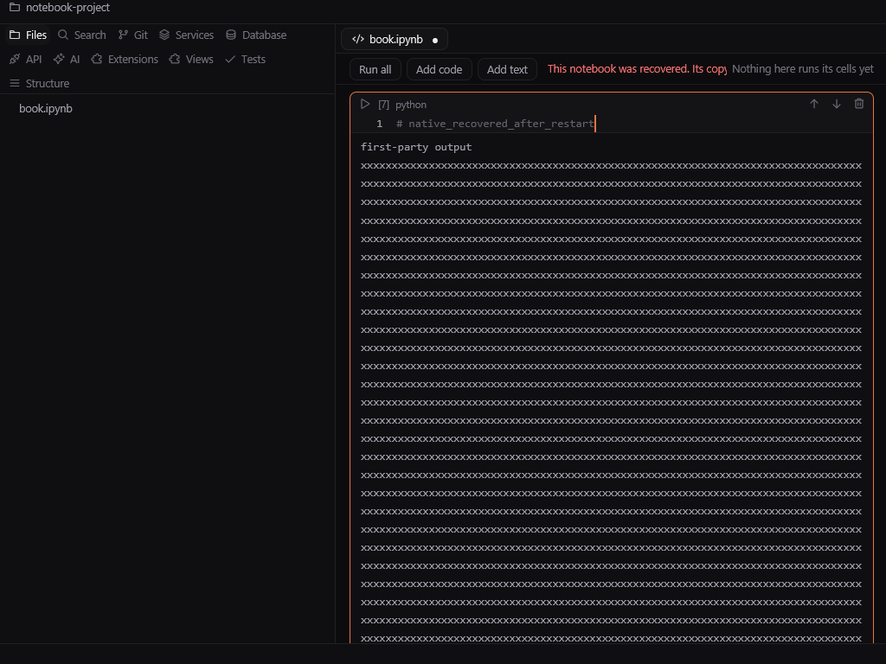
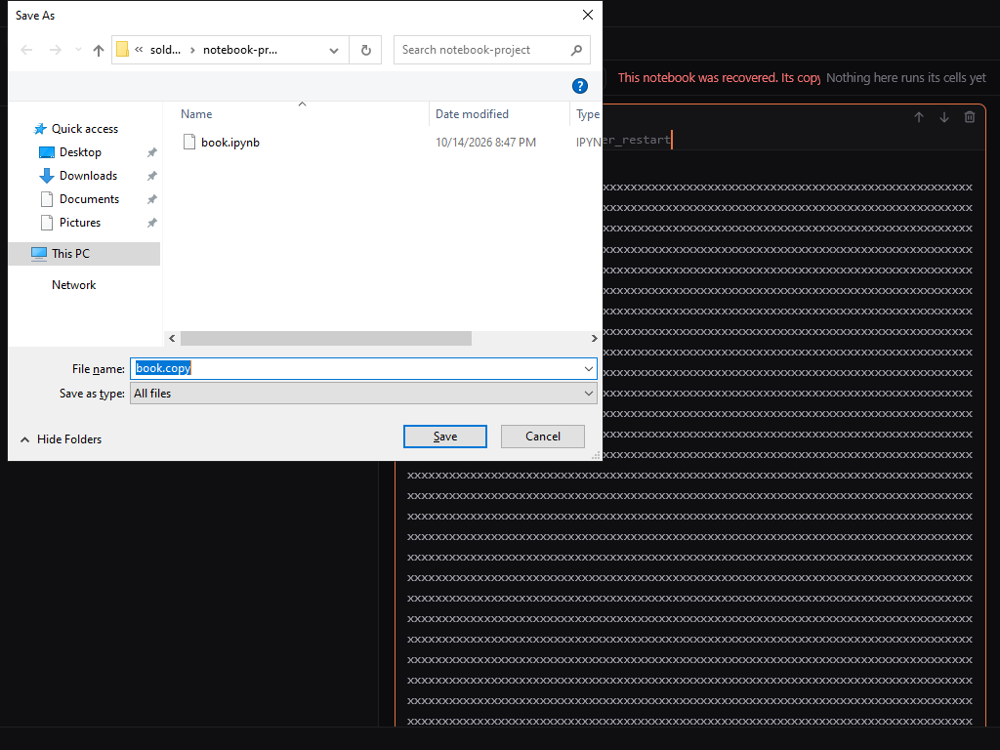

# Native Windows notebook verification

Evidence from [run 38633325807](https://github.com/cire362/solder/actions/runs/38633325807),
[source 9b96b01](https://github.com/cire362/solder/commit/9b96b01), reviewed on
2026-10-18. The Windows Server 2022 disposable runner used Rust 1.99.0 and a
real Win32 window with SendInput. GPUI's headless backend was not used.
No published extension was installed or executed.

All six native stages passed: CLI foreground over an empty session; notebook
editing and saving; recovery publication without modifying the source; abrupt
process termination and restart without a notebook argument; rescue export
through the system Save As dialog; recovered save and recovery cleanup.

The fixture includes 256 KiB of stream output, rich output, execution count,
cell ids, metadata, attachments and an unknown top-level field. Independently
re-reading the downloaded evidence confirmed complete JSON equality for saved,
exported and recovered models, both recovery snapshots and final cleanup.
The restored input was `# native_recovered_after_restart`. The input appended
after restart proves the recovered cell received real platform keyboard events.

`windows-native-notebook.json` retains hashes, checks and limits. The full source
artifact is linked by the run. This covers the built-in Jupyter reader on one
CI Windows desktop, not every Windows machine, extension notebooks, kernels,
ACLs, hard links, physical GPU behavior, power loss or independent views.
The narrow window clips the informational recovery notice; the existing roadmap
entry for notebook notices remains open.
